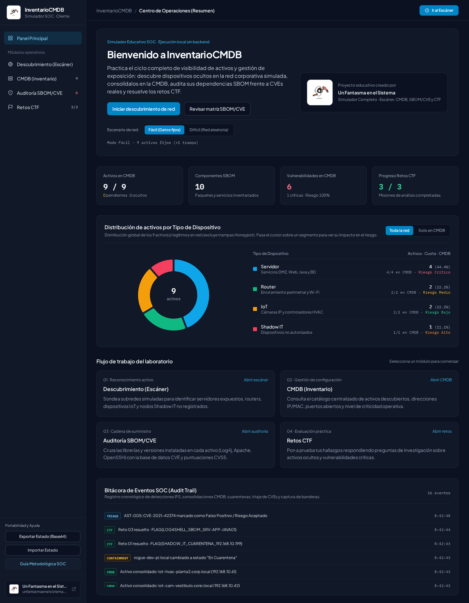
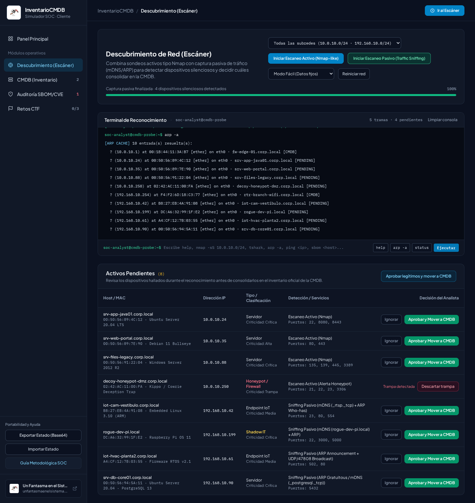
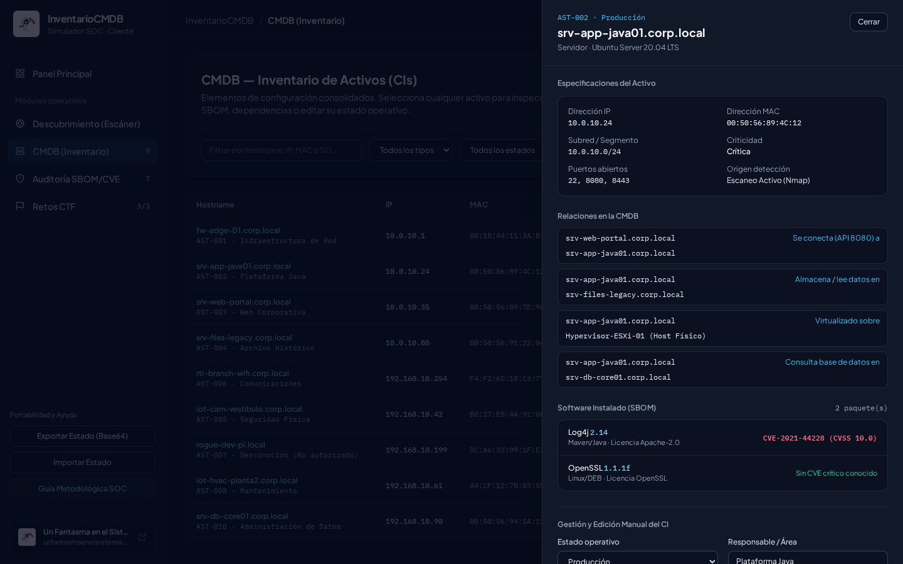
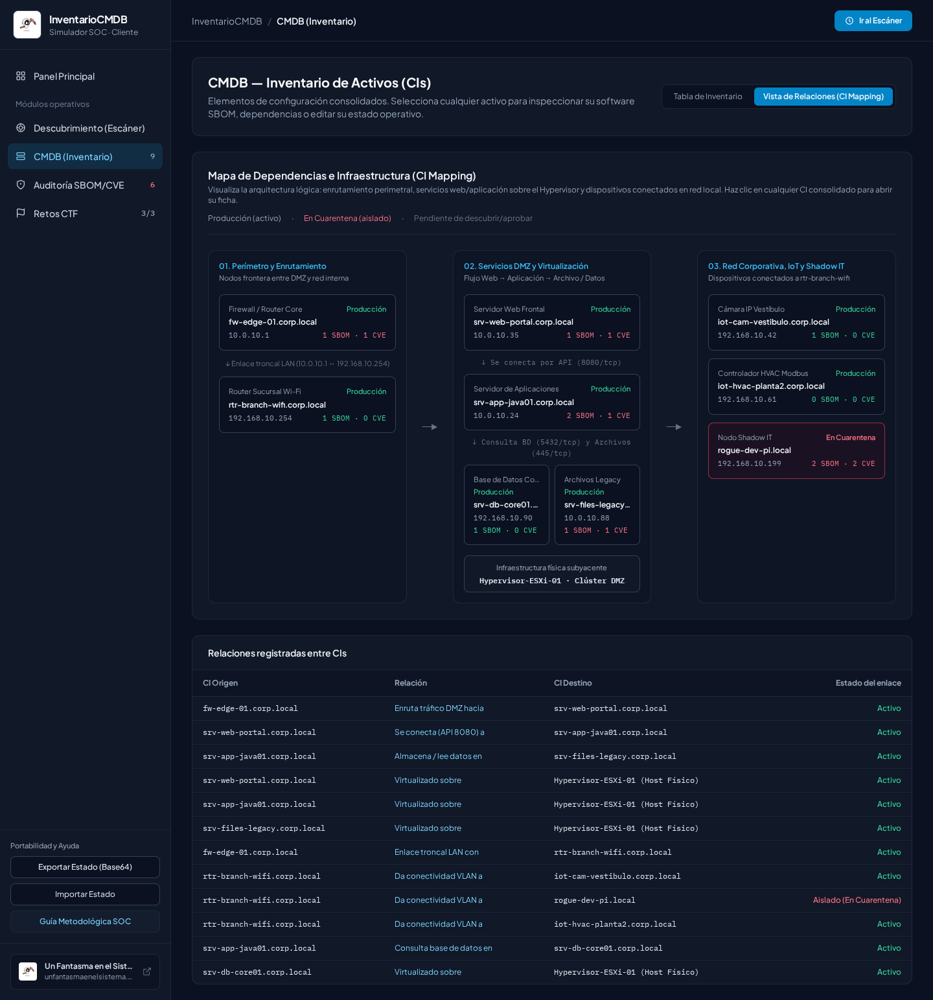
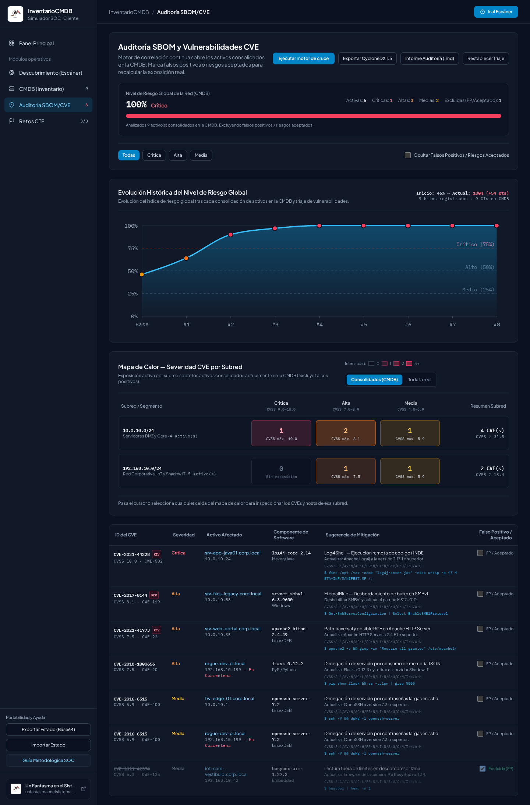
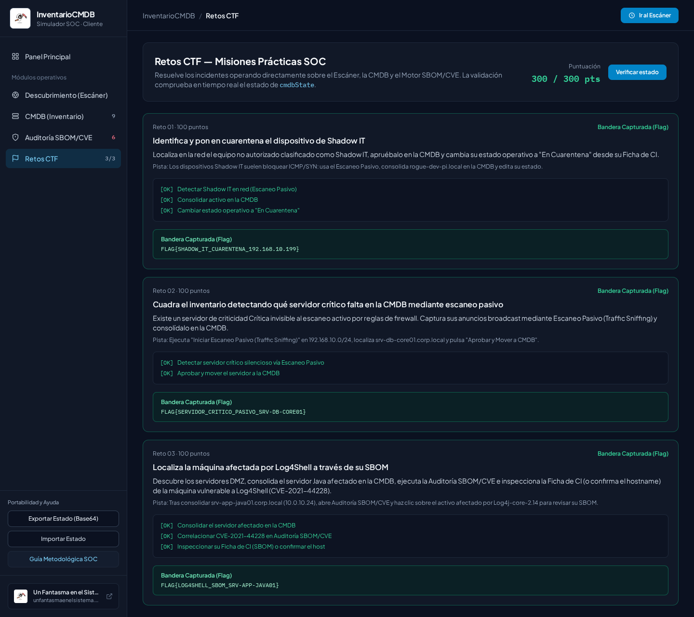

<div align="center">

<a href="https://www.unfantasmaenelsistema.com/" target="_blank" rel="noopener noreferrer">
  
</a>

# InventarioCMDB — Simulador SOC de Red, CMDB y Auditoría SBOM/CVE

**Laboratorio educativo 100 % en el cliente (HTML5 + Tailwind CSS + D3.js v7 + Vanilla ES6 JS)** para practicar descubrimiento de activos, gestión de configuración (CMDB/CI Mapping), correlación de dependencias SBOM contra vulnerabilidades CVE/CVSS/KEV y retos prácticos CTF.

[](#arquitectura-y-tecnolog%C3%ADas)
[](#arquitectura-y-tecnolog%C3%ADas)
[](#panel-principal-dashboard-soc-y-visualizaci%C3%B3n-d3js)
[](#exportaci%C3%B3n-profesional-y-portabilidad)
[](#despliegue-en-github-pages)
[](./LICENSE)

Proyecto educativo creado por **[Un Fantasma en el Sistema](https://www.unfantasmaenelsistema.com/)**

</div>

---

## Tabla de Contenidos

- [Descripción General](#-descripción-general)
- [Capturas Reales de la Aplicación](#-capturas-reales-de-la-aplicación)
- [Módulos y Capacidades](#-módulos-y-capacidades)
- [Modos de Dificultad (Fácil vs. Difícil)](#-modos-de-dificultad-fácil-vs-difícil)
- [Terminal Interactiva CLI](#-terminal-interactiva-cli)
- [Retos CTF Educativos](#-retos-ctf-educativos)
- [Exportación Profesional y Portabilidad](#-exportación-profesional-y-portabilidad)
- [Arquitectura y Tecnologías](#-arquitectura-y-tecnologías)
- [Despliegue en GitHub Pages](#-despliegue-en-github-pages)
- [Uso en Local](#-uso-en-local)

---

## Descripción General

**InventarioCMDB** reproduce el flujo completo de trabajo de un **Centro de Operaciones de Seguridad (SOC)** y un equipo de **Gestión de Activos y Vulnerabilidades**, sin necesidad de servidores, contenedores ni backend: todo el laboratorio vive en un único archivo `index.html` listo para servir de forma estática en GitHub Pages o abrir directamente en navegador.

El alumno o profesional asume el rol de **analista SOC** y recorre cuatro fases reales:

1. **Reconocimiento y Descubrimiento**: combinar escaneos activos ruidosos (`nmap -sS -sV`) —expuestos a bloqueos IPS/Honeypot— con captura pasiva de tráfico broadcast (`tshark` sobre ARP/mDNS/SSDP/BACnet) para descubrir dispositivos silenciosos, IoT, Shadow IT y servidores críticos ocultos tras reglas de firewall.
2. **Consolidación en CMDB y Mapeo de CIs**: validar hallazgos en la cola de *Activos Pendientes*, incorporarlos al inventario oficial, inspeccionar su **Ficha de CI**, revisar relaciones de dependencia (*Web → App → BD / Hypervisor*) y ejecutar contención inmediata (*En Cuarentena*).
3. **Auditoría SBOM/CVE**: correlacionar automáticamente el inventario de software instalado (**SBOM**) frente a vulnerabilidades **CVE** con vectores **CVSS v3.1**, identificadores **CWE**, catálogo **CISA KEV**, comandos de verificación y triaje de **Falsos Positivos / Riesgo Aceptado**.
4. **Evaluación Práctica (Retos CTF)**: validación automática en tiempo real contra el estado interno `cmdbState` con lista de verificación paso a paso y captura de banderas (`FLAG{...}`).

---

## Capturas Reales de la Aplicación

### 1. Panel Principal (Dashboard SOC, Donut D3.js y Bitácora Audit Trail)
Visualización de métricas globales en tiempo real, selector de escenario (**Fácil** vs. **Difícil**), gráfico circular interactivo con D3.js v7 (tooltip con porcentaje exacto e impacto de cada tipo de dispositivo en el riesgo global) y bitácora cronológica de eventos SOC.



---

### 2. Descubrimiento de Red (Escáner Activo/Pasivo + Terminal CLI + Activos Pendientes)
Consola interactiva con soporte de comandos (`nmap`, `tshark`, `arp -a`, `ping`, `sbom`, `status`), simulación de bloqueo automático por trampa **Honeypot / IPS**, detección silenciosa mediante sniffing pasivo y tabla de decisión para aprobar o descartar activos antes de consolidarlos.



---

### 3. CMDB (Inventario Consolidado) y Ficha Técnica de CI
Tabla filtrable por Hostname, IP, MAC, Tipo, SO y Estado Operativo, junto al panel lateral **Ficha de CI** con especificaciones de red, dependencias, listado SBOM correlacionado con CVEs, edición manual, cuarentena en un clic y exportación SBOM individual.



---

### 4. Vista de Relaciones (CI Mapping)
Mapa arquitectónico en tres capas (*Perímetro/Enrutamiento → Servicios DMZ y Hypervisor → Red Corporativa, IoT y Shadow IT*) con contadores de SBOM/CVE por nodo, resaltado visual de aislamiento cuando un CI entra *En Cuarentena* y matriz completa de enlaces.



---

### 5. Auditoría SBOM/CVE, Evolución Histórica (D3.js) y Mapa de Calor por Subred
Motor de correlación continua con indicador de **Nivel de Riesgo Global**, **gráfico lineal D3.js** de evolución histórica tras cada consolidación o triaje, **mapa de calor térmico por subred** (`10.0.10.0/24` DMZ vs. `192.168.10.0/24` Corporativa/IoT) con filtro cruzado, badges **CISA KEV**, vectores **CVSS v3.1**, comandos de comprobación y checkbox de **Falso Positivo / Riesgo Aceptado**.



---

### 6. Retos CTF con Validación Automática
Tres escenarios guiados con checklist dinámico sobre `cmdbState` y obtención de banderas (`FLAG{...}`) al completar los objetivos operativos en el Escáner, CMDB y SBOM/CVE.



---

## Módulos y Capacidades

| Módulo | Capacidades Técnicas Implementadas |
| :--- | :--- |
| **Panel Principal** | KPIs en vivo (`Activos en CMDB`, `Componentes SBOM`, `Vulnerabilidades`, `Retos CTF`), gráfico Donut D3.js por *Tipo de Dispositivo* con tooltip de impacto al riesgo global, conmutador de alcance (*Toda la red* vs. *Solo en CMDB*) y **Bitácora de Eventos SOC**. |
| **Descubrimiento (Escáner)** | Escaneo Activo tipo `nmap -sS -sV` (con bloqueo realista ante Honeypot), Escaneo Pasivo tipo `tshark` (ARP/mDNS/SSDP/BACnet), **Terminal CLI interactiva**, filtro por subred y tabla de *Activos Pendientes*. |
| **CMDB (Inventario)** | Tabla de activos consolidados con búsqueda multicampo, **Vista de Relaciones (CI Mapping)** con estado en tiempo real, **Ficha de CI** editable (Estado, Responsable, Notas, Cuarentena rápida) y exportación **CSV**. |
| **Auditoría SBOM/CVE** | Correlación `sbomDatabase ↔ cveDatabase`, barra de **Riesgo Global**, gráfico lineal **D3.js** de evolución histórica, **Mapa de Calor Subred × Severidad**, filtro de **Falsos Positivos / Riesgo Aceptado**, metadatos **CVSS v3.1 / CWE / CISA KEV**, exportación **CycloneDX 1.5 JSON** e **Informe SOC (.md)**. |
| **Retos CTF** | 3 misiones prácticas evaluadas automáticamente sobre `cmdbState` (compatibles tanto con Modo Fácil como con Modo Difícil) y **Guía Metodológica SOC** integrada. |

---

## Modos de Dificultad (Fácil vs. Difícil)

- **Modo Fácil (Datos fijos)**: Escenario determinista con **9 activos legítimos** (`fw-edge-01`, `srv-app-java01`, `srv-web-portal`, `srv-files-legacy`, `rtr-branch-wifi`, `iot-cam-vestibulo`, `rogue-dev-pi`, `iot-hvac-planta2`, `srv-db-core01`) y **1 trampa Honeypot** (`decoy-honeypot-dmz`). Ideal para prácticas guiadas en clase.
- **Modo Difícil (Red aleatoria)**: Ejecuta `multiplyNetworkAssetsRandomly()` para multiplicar dinámicamente Servidores, Routers, Endpoints IoT, Shadow IT y un segundo Honeypot interno sin colisiones de IP, MAC o hostname, generando nuevas dependencias CI y entradas SBOM aleatorias en cada reinicio.

La preferencia de modo y el progreso de la sesión se guardan localmente mediante `localStorage`.

---

## Terminal Interactiva CLI

Dentro de **Descubrimiento (Escáner)** se incluye una línea de comandos interactiva con historial (`↑` / `↓`) y accesos rápidos:

```bash
help                        # Muestra los comandos disponibles
nmap -sS 10.0.10.0/24       # Lanza escaneo activo sobre la subred DMZ
nmap -sS 192.168.10.0/24    # Lanza escaneo activo sobre la red corporativa
tshark                      # Captura pasiva broadcast (ARP/mDNS/BACnet)
arp -a                      # Muestra tabla ARP conocida (CMDB + Pendientes)
ping 10.0.10.24             # Sonda ICMP puntual (detecta hosts silenciosos o trampas)
sbom srv-app-java01         # Lista los componentes SBOM de un CI consolidado
status                      # Resumen rápido de CMDB, riesgo global y CVEs
clear                       # Limpia la salida de la terminal
```

---

## Retos CTF Educativos

| Reto | Objetivo Práctico | Puntuación |
| :--- | :--- | :---: |
| **Reto 01** | Identifica el dispositivo **Shadow IT** oculto mediante escaneo pasivo, consolídalo en la CMDB y ponlo en estado **En Cuarentena**. | 100 pts |
| **Reto 02** | Cuadra el inventario detectando mediante **Escaneo Pasivo** el servidor crítico con firewall estricto que falta en la CMDB. | 100 pts |
| **Reto 03** | Localiza la máquina afectada por **Log4Shell (`CVE-2021-44228`)** correlacionando su **SBOM (`log4j-core-2.14`)**. | 100 pts |

<details>
<summary>Ver guía de resolución paso a paso para docentes (Spoiler)</summary>

1. **Reto 01**: En *Descubrimiento*, ejecuta **Escaneo Pasivo** sobre `192.168.10.0/24`, aprueba `rogue-dev-pi.local` (`192.168.10.199`), abre su Ficha de CI en *CMDB* y pulsa **Poner en Cuarentena**.
2. **Reto 02**: En el mismo **Escaneo Pasivo** sobre `192.168.10.0/24`, aprueba `srv-db-core01.corp.local` (`192.168.10.90`).
3. **Reto 03**: Ejecuta **Escaneo Activo** (o `nmap -sS 10.0.10.0/24`), aprueba `srv-app-java01.corp.local` (`10.0.10.24`), revisa `CVE-2021-44228` en *Auditoría SBOM/CVE* y haz clic en su hostname para inspeccionar su Ficha de CI (o confirma el hostname en la tarjeta del Reto 03).

</details>

---

## Exportación Profesional y Portabilidad

- **Portabilidad de Laboratorio (Base64)**: Permite serializar el objeto completo `cmdbState` (activos, relaciones, SBOM, CVEs, triaje, historial de riesgo, bitácora y retos) a una cadena Base64 UTF-8 para guardar prácticas o distribuir escenarios personalizados entre profesorado y alumnado.
- **Exportar SBOM CycloneDX 1.5 (`.json`)**: Genera un documento JSON conforme a la especificación **CycloneDX 1.5** con `purl` (Package URL), licencias y vulnerabilidades asociadas (global o por CI individual).
- **Exportar Inventario CMDB (`.csv`)**: Descarga el inventario consolidado con codificación UTF-8 BOM compatible con Microsoft Excel y LibreOffice Calc.
- **Exportar Informe de Auditoría (`.md`)**: Genera un reporte ejecutivo en Markdown con resumen de riesgo, hallazgos KEV/CVSS y tabla de activos.

---

## Arquitectura y Tecnologías

- **Ejecución 100 % estática en cliente**: sin backend, sin dependencias de servidor ni claves API.
- **Archivo principal unificado**: [`index.html`](./index.html) (HTML5 semántico + Tailwind CSS CDN + D3.js v7 CDN + Vanilla JS ES6 `'use strict'`).
- **Seguridad incorporada**: sanitización de salidas dinámicas (`escapeHtml`) frente a XSS al editar fichas de CI o importar cadenas Base64 externas.
- **Estructura preparada para GitHub y GitHub Pages**:
  - `index.html` — Aplicación completa lista para servir directamente.
  - `assets/aistudio/icono_81a3db5b.png` — Emblema estático servido en ruta relativa.
  - `.nojekyll` — Evita el procesamiento Jekyll en GitHub Pages.
  - `.github/workflows/deploy-pages.yml` — Workflow automático de GitHub Actions para GitHub Pages.
  - `docs/screenshots/` — Capturas reales de la aplicación en funcionamiento.
  - `LICENSE` — Licencia MIT.

---

## Despliegue en GitHub Pages

### Opción A: Despliegue automático con GitHub Actions (Recomendada)
1. Sube este repositorio a GitHub en la rama `main`.
2. Ve a **Settings → Pages → Build and deployment → Source** y selecciona **GitHub Actions**.
3. El workflow incluido en [`.github/workflows/deploy-pages.yml`](./.github/workflows/deploy-pages.yml) publicará automáticamente la aplicación en `https://<tu-usuario>.github.io/<tu-repositorio>/`.

### Opción B: Despliegue directo desde la rama `main`
1. Ve a **Settings → Pages → Build and deployment → Source** y selecciona **Deploy from a branch**.
2. Elige la rama `main` y la carpeta `/ (root)` y guarda los cambios.
3. Gracias a `.nojekyll` y a las rutas relativas (`./assets/...`), la aplicación funcionará inmediatamente sin paso de compilación.

---

## Uso en Local

Puedes abrir `index.html` mediante cualquier servidor HTTP estático:

```bash
# Con Python 3
python3 -m http.server 8080

# O con Node.js / npx
npx serve .
```

Y acceder a `http://localhost:8080` en tu navegador.

---

<div align="center">
  Desarrollado con fines educativos por <a href="https://www.unfantasmaenelsistema.com/">unfantasmaenelsistema.com</a>
</div>
